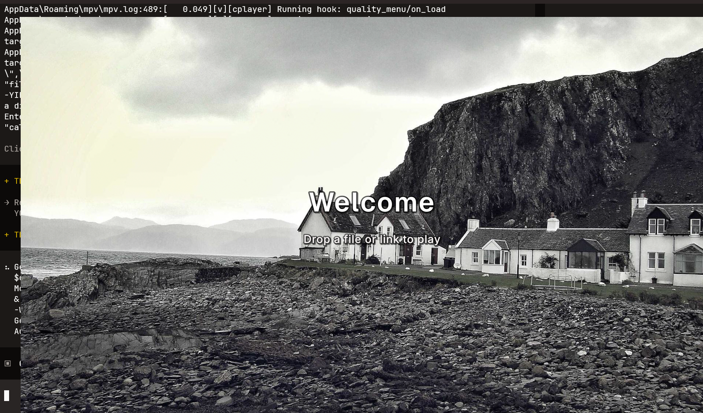
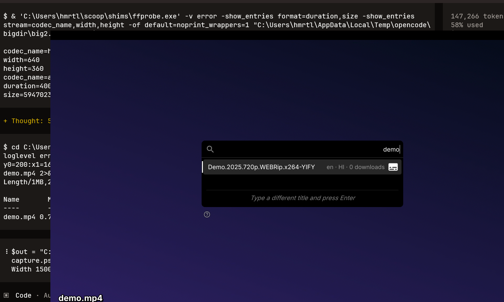
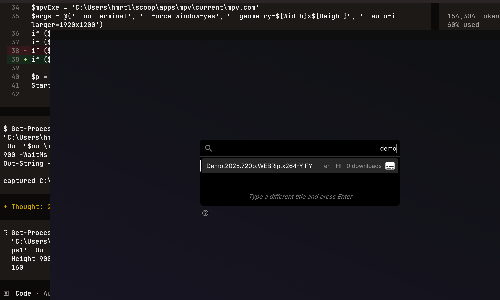
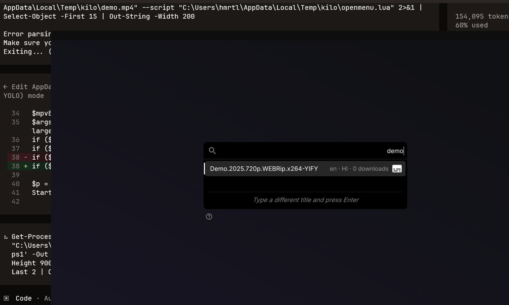

# mpv-redesigned

A tuned, single-command [mpv](https://mpv.io) configuration. Liquid Glass control bar, a full-quality `gpu-next` video pipeline, WASAPI audio, designed subtitle typography, and YouTube tooling — a real format picker, subtitles in every language, SponsorBlock, clip cutting, downloads and picture-in-picture. Installs with one command and backs up your existing config first.

<p align="center">
  <a href="LICENSE"></a>
  <a href="https://mpv.io"></a>
  <a href="#platforms-requirements"></a>
  <a href="#feature-grid"></a>
  <a href="#documentation-links"></a>
  <a href="https://github.com/ratuuul/mpv-redesigned/commits/main"></a>
</p>

<p align="center">
  <picture>
    
  </picture>
</p>

## Contents

- [One-command install](#one-command-install)
- [Feature grid](#feature-grid)
- [Screenshots gallery](#screenshots-gallery)
- [What's in the box — repository layout](#whats-in-the-box-repository-layout)
- [Configuration tour](#configuration-tour)
- [Platforms & requirements](#platforms-requirements)
- [Documentation links](#documentation-links)
- [Privacy & safety](#privacy-safety)
- [Licence](#licence)
- [Contributing & support](#contributing-support)

## One-command install

Open **PowerShell** (not cmd) and run:

```powershell
irm https://raw.githubusercontent.com/ratuuul/mpv-redesigned/main/install.ps1 | iex
```

From a clone:

```powershell
git clone https://github.com/ratuuul/mpv-redesigned.git
cd mpv-redesigned
powershell -ExecutionPolicy Bypass -File .\install.ps1
```

On Linux (installer arriving from the parallel agent):

```bash
curl -fsSL https://raw.githubusercontent.com/ratuuul/mpv-redesigned/main/install.sh | bash
```

What it does:

1. **Backs up** any existing configuration (`%APPDATA%\mpv` → `%APPDATA%\mpv-backup-<timestamp>`). Nothing is overwritten without a backup unless you pass `-NoBackup`.
2. **Copies** the config payload into `%APPDATA%\mpv` (Windows) or `~/.config/mpv` (Linux).
3. **Fetches** `yt-dlp.exe` into the config directory so mpv's `ytdl_hook` finds it first.
4. **Picks a skin** — Liquid Glass is active by default; swap to ModernZ with `switch-skin` (`.\switch-skin.cmd` on Windows, `scripts/switch-skin.sh` on Linux).
5. Installs mpv if it is missing, then **verifies** the configuration parses cleanly before finishing.

Flags:

| Flag | Effect |
|---|---|
| `-DryRun` | Print every action, change nothing. Safe to paste anywhere. |
| `-ConfigOnly` | Skip mpv and yt-dlp; deploy the configuration only. |
| `-InstallDir <path>` | Deploy somewhere other than `%APPDATA%\mpv` (useful for testing). |
| `-Force` | Do not ask before replacing an existing configuration. |
| `-NoBackup` | Do not back up. Destructive — use with care. |
| `-NoHistory` | Do not carry over `watch_later\` and `screenshots\`. |

Help: `Get-Help .\install.ps1` (or `help .\install.ps1`).

Uninstall:

```powershell
powershell -ExecutionPolicy Bypass -File .\uninstall.ps1
```

It moves `%APPDATA%\mpv` to a timestamped backup folder. `-Purge` deletes it instead (and asks first). mpv itself is left installed — remove it with `scoop uninstall mpv` or by deleting `%LOCALAPPDATA%\mpv`.

Full install details (manual, offline, age-restricted videos) are in [docs/INSTALL.md](docs/INSTALL.md).

## Feature grid

<div style="display:grid;grid-template-columns:repeat(auto-fit,minmax(260px,1fr));gap:12px;margin:16px 0;">

<div style="border:1px solid rgba(255,255,255,0.08);border-radius:10px;padding:14px 16px;background:rgba(0,0,0,0.25);">
<b>Liquid Glass skin</b><br>
Translucent glass control bar and timeline, centred macOS-style seek/volume/speed overlays, spring speedometer, buffering indicator, custom window border.<br>
<a href="docs/SKINS.md">docs/SKINS.md</a>
</div>

<div style="border:1px solid rgba(255,255,255,0.08);border-radius:10px;padding:14px 16px;background:rgba(0,0,0,0.25);">
<b>`gpu-next` + `d3d11va` zero-copy</b><br>
Hardware decode with frames kept in GPU memory — the single biggest win on shared-memory Intel graphics. Vulkan A/B via `Alt+0`.<br>
<a href="docs/FEATURES.md">docs/FEATURES.md</a>
</div>

<div style="border:1px solid rgba(255,255,255,0.08);border-radius:10px;padding:14px 16px;background:rgba(0,0,0,0.25);">
<b>Full-quality scalers</b><br>
EWA Lanczos luma, spline36 chroma, mitchell downscale, antiring 0.6, debanding with grain, fruit dither.<br>
<a href="docs/FEATURES.md">docs/FEATURES.md</a>
</div>

<div style="border:1px solid rgba(255,255,255,0.08);border-radius:10px;padding:14px 16px;background:rgba(0,0,0,0.25);">
<b>24p judder removal</b><br>
`video-sync=display-resample` + interpolation retimes 23.976/24 fps to a 60 Hz panel.<br>
<a href="docs/FEATURES.md">docs/FEATURES.md</a>
</div>

<div style="border:1px solid rgba(255,255,255,0.08);border-radius:10px;padding:14px 16px;background:rgba(0,0,0,0.25);">
<b>WASAPI audio + ReplayGain</b><br>
Shared-mode WASAPI (`mpv` in the volume mixer), track-mode ReplayGain, `volume-max=130`, gapless audio.<br>
<a href="docs/FEATURES.md">docs/FEATURES.md</a>
</div>

<div style="border:1px solid rgba(255,255,255,0.08);border-radius:10px;padding:14px 16px;background:rgba(0,0,0,0.25);">
<b>Designed subtitles</b><br>
Geist Medium 40, warm off-white, hairline outline + soft shadow, letterbox margins, gentle ASS restyle.<br>
<a href="docs/FEATURES.md">docs/FEATURES.md</a>
</div>

<div style="border:1px solid rgba(255,255,255,0.08);border-radius:10px;padding:14px 16px;background:rgba(0,0,0,0.25);">
<b>YouTube format picker</b><br>
Lists the real formats the server offers and switches without reloading (`F` video, `Alt+f` audio).<br>
<a href="docs/FEATURES.md">docs/FEATURES.md</a>
</div>

<div style="border:1px solid rgba(255,255,255,0.08);border-radius:10px;padding:14px 16px;background:rgba(0,0,0,0.25);">
<b>YouTube subtitle picker</b><br>
Every creator-uploaded and auto-generated track, every language, cached after first fetch (`Alt+s`).<br>
<a href="docs/FEATURES.md">docs/FEATURES.md</a>
</div>

<div style="border:1px solid rgba(255,255,255,0.08);border-radius:10px;padding:14px 16px;background:rgba(0,0,0,0.25);">
<b>SponsorBlock</b><br>
Skip sponsor/intro/outro/self-promo segments per video (`b`).<br>
<a href="docs/FEATURES.md">docs/FEATURES.md</a>
</div>

<div style="border:1px solid rgba(255,255,255,0.08);border-radius:10px;padding:14px 16px;background:rgba(0,0,0,0.25);">
<b>Clip cutter</b><br>
Frame-accurate range picker, H.264/AAC at CRF 18, ~5 MB target, written next to the source (`W`).<br>
<a href="docs/FEATURES.md">docs/FEATURES.md</a>
</div>

<div style="border:1px solid rgba(255,255,255,0.08);border-radius:10px;padding:14px 16px;background:rgba(0,0,0,0.25);">
<b>Download stream</b><br>
Save what you are watching at the quality mpv negotiated, with live progress and no overwrites (`Ctrl+d`).<br>
<a href="docs/FEATURES.md">docs/FEATURES.md</a>
</div>

<div style="border:1px solid rgba(255,255,255,0.08);border-radius:10px;padding:14px 16px;background:rgba(0,0,0,0.25);">
<b>Picture-in-picture</b><br>
Borderless always-on-top mini player anchored above the taskbar; restores the exact previous window state (`Alt+p`).<br>
<a href="docs/FEATURES.md">docs/FEATURES.md</a>
</div>

<div style="border:1px solid rgba(255,255,255,0.08);border-radius:10px;padding:14px 16px;background:rgba(0,0,0,0.25);">
<b>Idle photo background</b><br>
Fetched photograph with "Welcome / Drop a file or link to play" overlay while mpv is idle (`Ctrl+Shift+K`).<br>
<a href="docs/FEATURES.md">docs/FEATURES.md</a>
</div>

</div>

## Screenshots gallery

<p align="center">

| | |
|---|---|
|  |  |
| Idle welcome screen — random photo background + "Welcome / Drop a file or link to play" overlay. | Video playing with the Liquid Glass control bar. |
|  |  |
| Volume slider / mute button in its Liquid Glass hover state. | Autosubs subtitle-search menu panel. |

</p>

## What's in the box — repository layout

Annotated tree (paths relative to the repository root):

```
mpv-redesigned/
├─ install.ps1              Windows installer — one-click (irm | iex or from a clone)
├─ install.sh               Linux installer — added in parallel (not yet in the repo)
├─ uninstall.ps1            Backup-or-delete the installed configuration
├─ config/                  Exactly what lands in %APPDATA%\mpv (Windows) / ~/.config/mpv (Linux)
│  ├─ mpv.conf              Master file; includes conf/*.conf
│  ├─ input.conf            One keymap, routed through nav_shim for both skins
│  ├─ conf/
│  │  ├─ video.conf         Renderer, hardware decode, scaling, tonemapping
│  │  ├─ audio.conf         WASAPI, volume, ReplayGain, track selection
│  │  ├─ subtitles.conf     Typography, colour, ASS overrides
│  │  ├─ interface.conf     Window chrome, OSD, screenshots
│  │  └─ profiles.conf      Conditional + on-demand profiles
│  ├─ scripts/
│  │  ├─ uosc/              Liquid Glass skin (uosc v5.9.2 fork, LGPL-2.1)
│  │  ├─ nav_shim.lua       Skin-aware navigation (one keymap, both skins)
│  │  ├─ ytsubs.lua         YouTube subtitle picker
│  │  ├─ download.lua       Download the current stream
│  │  ├─ pip.lua            Picture-in-picture / mini player
│  │  ├─ autosubs.lua       Automatic OpenSubtitles lookup
│  │  ├─ bg.lua             Idle photo background
│  │  ├─ quality-menu.lua   Real format picker
│  │  ├─ thumbfast.lua      Seekbar thumbnail previews
│  │  ├─ sponsorblock_minimal.lua  SponsorBlock segment skipping
│  │  ├─ recentmenu.lua     Recent files menu
│  │  ├─ webm.lua           Clip cutter
│  │  └─ lasthit.lua        Double-click to resume last media
│  ├─ script-opts/          Per-script options (bg, pip, webm, ytsubs, …)
│  ├─ shaders/              Anime4K + chroma-from-luma (5 GLSL files)
│  ├─ fonts/                Geist, Inter, Source Sans 3, Material Icons
│  ├─ skins/modernz/        Parked alternative skin
│  ├─ switch-skin.ps1/.cmd  Swap the active skin (Windows)
│  ├─ switch-skin.sh        Swap the active skin (Linux, added in parallel)
│  └─ README.md             Config's own reference notes
├─ docs/                    INSTALL, FEATURES, KEYBINDINGS, SKINS, ARCHITECTURE, TROUBLESHOOTING
├─ tools/                   gen-keybindings.ps1, sync-config.ps1
├─ licenses/                Full licence texts
├─ LICENSE                  MIT (original work)
├─ THIRD_PARTY_NOTICES.md   Per-component attribution
└─ site/assets/images/      hero-idle, player-controls, volume-hover, menu-autosubs
```

Shipped scripts and what each does:

| Script | What it does |
|---|---|
| `uosc/` | Liquid Glass skin — uosc v5.9.2 fork with a glass visual layer (LGPL-2.1) |
| `nav_shim.lua` | Routes one keymap onto the active skin's navigation |
| `ytsubs.lua` | YouTube subtitle picker — every language, cached to `cache/ytsubs/` |
| `download.lua` | Download the current stream at negotiated quality (`Ctrl+d`) |
| `pip.lua` | Picture-in-picture / always-on-top mini player (`Alt+p`) |
| `autosubs.lua` | Automatic OpenSubtitles lookup for local files (`Alt+o`) |
| `bg.lua` | Idle photo background with welcome overlay (`Ctrl+Shift+K`) |
| `quality-menu.lua` | Real server format picker (`F`, `Alt+f`) |
| `thumbfast.lua` | Seekbar thumbnail previews |
| `sponsorblock_minimal.lua` | SponsorBlock segment skipping (`b`) |
| `recentmenu.lua` | Recent files menu (`Ctrl+Shift+r`) |
| `webm.lua` | Clip cutter — H.264/AAC range encoder (`W`) |
| `lasthit.lua` | Double-click the window to reopen and resume the last media |

## Configuration tour

### Skins

Two skins ship; exactly one is active at a time. The active skin lives under `scripts/` so mpv puts its directory on the Lua module path (uosc requires `lib/std`, `elements/Controls`, …).

| | Liquid Glass | ModernZ |
|---|---|---|
| Default | yes | no, parked |
| Active location | `scripts\uosc\` | `scripts\modernz\` |
| Parked location | `skins\liquid-glass\uosc\` | `skins\modernz\` |
| Upstream | tomasklaen/uosc v5.9.2 (fork) | Samillion/ModernZ v0.3.3 |
| Licence | LGPL-2.1 | LGPL-2.1 |
| Switch with | `.\switch-skin.cmd liquidglass` | `.\switch-skin.cmd modernz` |

Restart mpv after switching. Full details: [docs/SKINS.md](docs/SKINS.md).

### Idle background + welcome overlay

While mpv is idle, `scripts/bg.lua` shows a full-window photograph (fetched asynchronously, validated by magic bytes before display) with the idle cat and the "Welcome / Drop a file or link to play" overlay drawn on top. Press `Ctrl+Shift+K` for the next photo. Photos are cached in `cache\bg\` (bounded by `cache_size=20`; oldest deleted first) so the idle screen works offline after the first fetch. The source list defaults to `picsum` (loremflickr and source.unsplash are dead ends and not used by default). Set `enabled=no` in `script-opts/bg.conf` to turn it off.

### Double-click to resume

Double-clicking the window reopens the last played media and resumes it from the exact saved position (`scripts/lasthit.lua`, bound to `MBTN_LEFT_DBL`). This takes over mpv's default double-click fullscreen toggle — press `f` for fullscreen instead. Background photos are ignored, so only real media is reopened.

### YouTube

The `ytdl-raw-options` line in `mpv.conf`:

```ini
ytdl-raw-options=sub-langs=(en|ja|de|es|fr|it|ru|pt|pl|nl|sv|tr|ko|zh).*,js-runtimes=node
```

- `sub-langs=...` — creator-uploaded subtitles in the listed languages become normal mpv tracks, so they appear in `v`, the skin's Subtitles menu and mpv's own track list. Auto-generated captions are deliberately not requested (100+ tracks per video); use the ytsubs menu (`Alt+s`) instead.
- `js-runtimes=node` — required for full quality. Without a JS runtime yt-dlp cannot solve YouTube's signature and `n` challenges, YouTube forces SABR streaming and the format list comes back empty. Needs Node.js on `PATH` (`winget install OpenJS.NodeJS.LTS` or `scoop install nodejs-lts`). Comment the option out if you cannot install Node; YouTube still plays at lower pre-merged qualities.
- `cookies-from-browser=firefox` is **not** shipped. Add it yourself only if you need age-restricted / members-only videos — it hard-fails when that Firefox profile does not exist and then *all* YouTube playback stops. Chrome/Edge/Chromium cookies are app-bound encrypted and yt-dlp aborts with "Failed to decrypt with DPAPI".

Format picker (`F` video, `Alt+f` audio, `Ctrl+r` reload) lists the real formats the server offers — codec, resolution, bitrate, fps — and switches without reloading. Subtitle picker (`Alt+s`, `Alt+Shift+s` secondary) lists every subtitle YouTube offers, cached after the first fetch.

### SponsorBlock

`b` toggles SponsorBlock segment skipping. Segments are fetched per video and skipped by seeking. Categories: `sponsor;intro;outro;selfpromo;interaction;preview;music_offtopic` (`script-opts/sponsorblock_minimal.conf`). Note: `preview` can clip legitimate story content in episodic videos.

### Thumbnails

`scripts/thumbfast.lua` spawns a headless mpv to decode seekbar thumbnails (`hwdec=no`, `network=no` on Windows to avoid a d3d11va deadlock with the main decoder). The skin only renders them. `network=yes` enables YouTube previews but doubles bandwidth and often stalls.

### WebM clip cutting

`W` opens the range picker (mpv-webm). Configured in `script-opts/webm.conf` to write **H.264/AAC at CRF 18** (`output_format=avc`, `crf=18`, `target_filesize=5000` kB) at source resolution, next to the source file — far faster than the script's CPU-only VP8 default. Output never overwrites (existing file becomes `…[2].mp4`).

### Picture-in-picture

`Alt+p` (`scripts/pip.lua`) shrinks the window to 480×270, removes the border, pins it always-on-top and anchors it to the bottom-right of the monitor's work area (above the taskbar). Portrait videos get a portrait window. Toggling again restores the previous ontop/border/geometry/size/fullscreen state exactly. Tunable in `script-opts/pip.conf`.

### Subtitles

- Geist Medium at 40, warm off-white (`#F5F2EF`), hairline outline (`1.15`) plus soft shadow (`blur=0.3`), centred near the bottom.
- `sub-ass-force-margins=yes` — subtitles sit inside the letterbox bars of 2.35:1 films instead of floating over them.
- Gentle restyle of the `Default` style of fansub ASS files so they match plain-text subtitles (signs and italics keep their identity).
- PGS/VobSub bitmap subs are softened (`sub-gauss=0.6`, `sub-gray`), not restyled — they are pre-rendered images.
- Two opt-in looks: Netflix-style translucent panel (`Alt+6`, `subs-panel`) and shadow-only cinema subtitles (`Alt+7`, `subs-cinema`).
- Automatic OpenSubtitles lookup for local files when no track exists (`Alt+o` to re-run); subtitle menus via `V` / `D`; sidecar discovery with `audio-file-auto=fuzzy` / `sub-auto=fuzzy`.

Full typography: [docs/FEATURES.md#subtitles](docs/FEATURES.md#subtitles).

### Hardware decoding + Anime4K

- Default renderer: `vo=gpu-next`, `gpu-api=d3d11`, `hwdec=d3d11va`, `d3d11va-zero-copy=yes` — zero-copy decode on shared-memory Intel graphics.
- Anime4K line-art restoration applies **automatically** to any file whose path contains `anime` (conditional profile `anime-restore`, plus a softer `anime-restore-soft` variant at ≤720p): `Anime4K_Clamp_Highlights.glsl` + `Anime4K_Restore_CNN_M.glsl` + `CfL_Prediction.glsl`. Force it on for one session with `Alt+4` (`shaders-anime`), off with `Alt+5` (`shaders-off`).
- Shader cache (`gpu-shader-cache-dir=~~/cache/gpu-shaders`) so the first play of a file does not stutter while the driver compiles pipelines.

### Profiles

| Profile | Key | Effect |
|---|---|---|
| `fast` | `Alt+1` | Bilinear scalers, no interpolation, no debanding — the escape hatch |
| `max-quality` | `Alt+2` | `ewa_lanczos4sharpest`, `cscale=ewa_lanczossharp`, deband x4 |
| `cine` | `Alt+3` | `spline36`, no interpolation, light deband |
| `shaders-anime` | `Alt+4` | Anime4K Restore (M) + CfL |
| `shaders-off` | `Alt+5` | No user shaders |
| `subs-panel` | `Alt+6` | Netflix-style translucent subtitle panel |
| `subs-cinema` | `Alt+7` | Shadow only, no outline |
| `loudnorm` | `Alt+8` | EBU R128 loudness normalisation |
| `dynaudnorm` | `Alt+9` | Gentle dynamic normalisation |
| `gpu-vulkan` | `Alt+0` | Vulkan renderer (A/B against d3d11) |

Conditional (automatic) profiles: `anime-restore`, `anime-restore-soft` (path contains `anime`), `gpu-d3d11` (default). Any profile can also be applied from the command line: `mpv --profile=fast <file>`.

### Key bindings

Condensed list. The complete list, generated from `config/input.conf`, is in [docs/KEYBINDINGS.md](docs/KEYBINDINGS.md).

| Key | Action |
|---|---|
| `Left` / `Right` | Seek −5 s / +5 s (wheel scrubs too) |
| `Shift+Left` / `Right` | Seek ∓1 s, frame exact |
| `Up` / `Down` | Volume ±5 |
| `0`–`9` (and numpad) | Jump to 0 % … 90 % |
| `{` / `}` / `BS` | Slower / faster / normal speed |
| `Space` / right-click | Pause |
| `F` / `Alt+f` | YouTube video / audio format picker |
| `Alt+s` / `Alt+Shift+s` | YouTube subtitle picker / secondary |
| `Ctrl+d` | Download the video you are watching |
| `Alt+p` | Mini always-on-top player |
| `W` | Cut a clip (H.264/AAC) |
| `b` | Toggle SponsorBlock skipping |
| `s` / `S` | Screenshot with / without subtitles |
| `V` / `D` | Subtitle menu / download subtitles |
| `Alt+1`…`Alt+0` | Performance and quality profiles |
| `Ctrl+Shift+K` | Next idle background photo |
| `Ctrl+Shift+r` | Recent files |
| Double-click window | Reopen and resume last media |

Navigation keys route through `scripts/nav_shim.lua`, so they behave identically under Liquid Glass and ModernZ.

## Platforms & requirements

| | |
|---|---|
| Windows | 10 or 11, x86-64; PowerShell 5.1 (built in) or PowerShell 7. Installer target, fully verified. |
| Linux | X11 / Wayland. The config is cross-platform; `install.sh` and `scripts/switch-skin.sh` are being added in parallel — best-effort until they land. |
| mpv | 0.41+ (built and tested against mpv 0.41-dev / libplacebo 7.358.0). |
| yt-dlp | Fetched by the installer into the config directory (official release). |
| Node.js | Optional, on `PATH` — required for full-quality YouTube (`js-runtimes=node`). Not installed by the installer. |
| Disk | ~60 MB for the configuration and shader cache; ~150 MB more if mpv must be installed. |
| Rights | No administrator rights — everything goes to your user profile. |

**Verified vs best-effort.** Measured on the reference machine: Windows 10 IoT Enterprise LTSC 19044, 1920×1200 @ 60 Hz panel, Intel integrated graphics (~2 GB shared VRAM), mpv 0.41-dev / libplacebo 7.358.0:

- `d3d11va` and Vulkan hwdec both decode 1080p and 4K with **0 dropped frames**; rendered output is pixel-identical (PSNR ≈ 66.5 dB), so the d3d11 default is about driver maturity, not picture quality.
- The full-quality stack (`ewa_lanczossharp` + `spline36` + debanding + interpolation) runs with **0 dropped frames at 1920×1200** on this iGPU.

Everything else — other GPUs, other mpv builds, Wayland, non-Windows — is best-effort. The measured claims above are specific to that machine; your mileage may vary.

## Documentation links

| Doc | What it covers |
|---|---|
| [docs/README.md](docs/README.md) | Documentation index |
| [docs/INSTALL.md](docs/INSTALL.md) | Manual install, offline install, installer FAQ, age-restricted videos, Node.js |
| [docs/FEATURES.md](docs/FEATURES.md) | Every feature, exact option, how to tune it |
| [docs/KEYBINDINGS.md](docs/KEYBINDINGS.md) | Full key binding reference, generated from input.conf |
| [docs/SKINS.md](docs/SKINS.md) | Liquid Glass vs ModernZ, switching, the module-path rule |
| [docs/ARCHITECTURE.md](docs/ARCHITECTURE.md) | Why the config is split, why the skin lives in scripts/, why d3d11 |
| [docs/TROUBLESHOOTING.md](docs/TROUBLESHOOTING.md) | Real failures hit while building the config, with fixes |
| [CONTRIBUTING.md](CONTRIBUTING.md) | How to contribute |
| [SECURITY.md](SECURITY.md) | Security policy and disclosure |

`docs/README.md`, `CONTRIBUTING.md` and `SECURITY.md` are maintained by the docs agent and arrive in parallel — the links point at their intended locations.

## Privacy & safety

What the configuration downloads at runtime:

- `yt-dlp.exe` from the official yt-dlp release, into the config directory (where mpv's `ytdl_hook` looks first).
- Idle background photographs from public random-photo services (`picsum.photos` is the default source; `loremflickr` and `source.unsplash` are dead ends and not used by default). Photos are cached locally under `cache\bg\`.

What it never stores:

- No accounts, no sign-in, no viewing history beyond mpv's own local `watch_later\` resume points.
- No browser cookies are shipped. `cookies-from-browser` is optional and must be added by you; it only affects age-restricted videos.
- No personal data is collected, uploaded or phoned home.

**No telemetry is included.** mpv and yt-dlp are not redistributed here; the installer downloads them from their official upstreams.

## Licence

The original work here — configuration, PowerShell installers, documentation and the scripts written for this project — is **MIT**. See [LICENSE](LICENSE).

Third-party components bundled or fetched by the installer:

| Component | Licence |
|---|---|
| mpv-redesigned (config, installers, docs, original scripts) | MIT |
| uosc fork — Liquid Glass skin | LGPL-2.1 |
| ModernZ skin | LGPL-2.1 |
| thumbfast | GPL-2.0 |
| quality-menu | GPL-3.0 |
| mpv-webm | GPL-3.0 |
| sponsorblock_minimal | MIT |
| recentmenu | MIT |
| Anime4K shaders + CfL_Prediction | MIT |
| Geist, Inter, Source Sans 3 fonts | OFL-1.1 |
| Material Icons Round font | Apache-2.0 |

mpv and yt-dlp are **not** redistributed here; the installer downloads them from their official upstreams. Full licence texts are in [`licenses/`](licenses/); per-component attribution is in [THIRD_PARTY_NOTICES.md](THIRD_PARTY_NOTICES.md).

## Contributing & support

- Found a bug or have an idea? [Open an issue](https://github.com/ratuuul/mpv-redesigned/issues).
- Security concerns: use the GitHub Security Advisory process for the repository — no e-mail address is published here.
- Contributing: see [CONTRIBUTING.md](CONTRIBUTING.md).

Built on [mpv](https://mpv.io), [uosc](https://github.com/tomasklaen/uosc), [ModernZ](https://github.com/Samillion/ModernZ), [yt-dlp](https://github.com/yt-dlp/yt-dlp), [Anime4K](https://github.com/bloc97/Anime4K) and the Geist / Inter / Source Sans 3 / Material Icons fonts.
